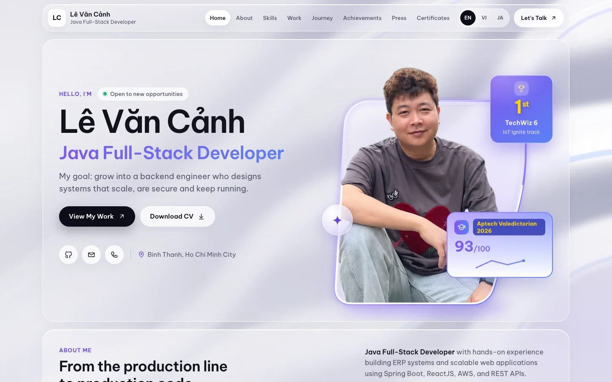

# Lê Văn Cảnh · Java Full-Stack Developer

    

Personal portfolio of a Java Full-Stack Developer based in Ho Chi Minh City, Vietnam.

**Live site: [canhle1993.github.io/canhle-portfolio](https://canhle1993.github.io/canhle-portfolio/)**

[](https://canhle1993.github.io/canhle-portfolio/)

## About me

I build ERP systems and web applications with Spring Boot, ReactJS, AWS and REST APIs. Before software, I spent seven years leading a 20-person production line at Samsung, which is where I learned to ship on time and measure results.

- **Aptech Valedictorian 2026:** ADSE program, 93/100 overall
- **1st place, TechWiz 6 (IoT Ignite track):** BreatheSafe, a real-time air quality system built in 5 days
- **Production experience:** features used by 50+ people every day in the Nichietsu ERP
- **Goal:** grow into a backend engineer who designs systems that scale, are secure and keep running

## Featured projects

| Project | What it is | Stack | Links |
|---|---|---|---|
| **Multi-Vendor E-Commerce** | Marketplace for buyers, sellers and admins with multi-shop checkout, a money ledger and shipping. ~380 API endpoints. Team Lead, scored 99/100 | Spring Boot, ReactJS | Private, demo on request |
| **Construction Site ERP** | Construction site module in a live ERP, connected to quotation, warehouse, sales and debt. 50+ daily users, ~40% less manual scheduling | Java full-stack | Company project |
| **Neural Image Captioning** | Model that writes English captions for photos. ACNPRO-AI capstone, scored 94/100 | Python, PyTorch | Private |
| **BreatheSafe** | Real-time air quality monitoring from sensors to a web dashboard. 1st place, TechWiz 6 | Raspberry Pi, MongoDB, ThingSpeak | |
| **PharmaTech** | Pharmaceutical equipment platform with quotes, deposit ordering, Stripe payments, recruitment and real-time chat | Angular, NestJS, MongoDB | [Showcase](https://github.com/canhle1993/PharmaTech-showcase) · [Live demo](http://103.153.72.209:4201/home) |
| **Library Management** | Desktop app for rentals, QR inventory, audio book descriptions and reports. Team Leader, scored 98/100 | Java Swing, SQL Server | [Showcase](https://github.com/canhle1993/LibraryManagement-showcase) |
| **Bakerz Bite** | Bakery e-commerce with health-based suggestions, rewards and Power BI admin reports | Laravel, MySQL | [Showcase](https://github.com/canhle1993/Bakerz-showcase) · [Live demo](http://103.153.72.209/filter) |

Full details, screenshots and press coverage are on the [live site](https://canhle1993.github.io/canhle-portfolio/#projects).

## Main skills

- **Backend:** Java, Spring Boot, Spring Security, Hibernate / JPA, REST APIs, Node.js, NestJS
- **Frontend:** ReactJS, Angular, TypeScript, JavaScript
- **Database:** MySQL, SQL Server, Oracle, PostgreSQL, MongoDB, Redis
- **DevOps & cloud:** Docker, GitHub Actions, Linux, Nginx, AWS

The site lists all 58 technologies I have worked with.

## About this site

- Plain HTML, CSS and JavaScript, with no framework and no build step
- English, Vietnamese and Japanese, switchable at any time and remembered per visitor
- Glassmorphism design that stays responsive down to small phones
- Lighter effects on touch devices so it runs smoothly on iPhone Safari
- Contact form that delivers straight to my inbox through Web3Forms

Run it locally:

```bash
python3 -m http.server 8000
```

Then open http://localhost:8000. Maintenance notes (in Vietnamese) are in [docs/maintenance-vi.md](docs/maintenance-vi.md).

## Contact

- Email: [aplevancanh1993@gmail.com](mailto:aplevancanh1993@gmail.com)
- Portfolio: [canhle1993.github.io/canhle-portfolio](https://canhle1993.github.io/canhle-portfolio/)
- CV: [Le-Van-Canh-CV.pdf](assets/Le-Van-Canh-CV.pdf)
